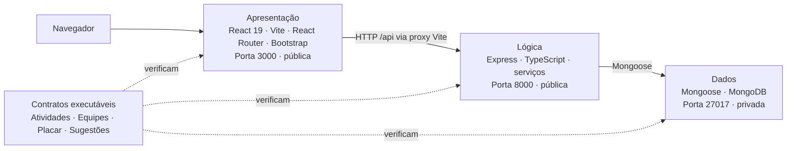

# Arquitetura do OctoFit Tracker

O OctoFit Tracker é uma aplicação de três camadas para um programa de atividades físicas escolar. O código inicial inclui contratos de API e pontos de implementação intencionalmente incompletos para que você use o modo agent do GitHub Copilot em um ciclo guiado por testes.

## Limites entre as camadas

- **Camada de apresentação**: React 19, Vite, React Router, Bootstrap e um cliente compartilhado da API em `octofit-tracker/frontend/src`.
- **Camada de lógica**: rotas e serviços Express com TypeScript em `octofit-tracker/backend/src` expõem o comportamento `/api/*` na porta `8000`.
- **Camada de dados**: modelos Mongoose e dados de demonstração em `octofit-tracker/backend/src/models` e `src/scripts/seed.ts` são persistidos no MongoDB na porta `27017`.

## Portas e regras de ambiente

- MongoDB: `27017` (privada)
- API Express: `8000` (pública)
- Interface Vite: `3000` (pública)
- O navegador acessa caminhos relativos `/api`. O Vite os encaminha para `http://localhost:8000`; `VITE_API_BASE_URL` pode substituir a URL-base.
- Não encaminhe nem torne públicas outras portas.

## Contrato da API

| Capacidade | Método e caminho | Comportamento esperado |
| --- | --- | --- |
| Registro de atividades | `GET /api/activities`, `POST /api/activities` | Lista e cria atividades válidas. POST recebe `userId`, `teamId`, `type` e `minutes`; `userId` e `teamId` devem ser IDs bem-formados de uma pessoa e uma equipe existentes, caso contrário a API retorna um 4xx intencional (nunca um 500 causado por erro de conversão). Uma atividade criada armazena `user`, `team`, `type` e `minutes` enviados, além de `points` e `occurredAt` calculados. |
| Equipes | `GET /api/teams`, `POST /api/teams` | Lista e cria equipes com integrantes. As equipes criadas e listadas mantêm os valores enviados em `name` e `mascot`. Rejeita uma equipe sem nome com `400`. |
| Placar | `GET /api/leaderboard` | Retorna as equipes ordenadas pela soma dos pontos de suas atividades, da maior para a menor. Cada item contém `teamName`, `totalPoints` e uma `rank` iniciada em 1. |
| Sugestões de treino | `GET /api/workouts/suggestions/:userEmail` | Recomenda treinos com base nos padrões de atividade recentes da pessoa correspondente ao e-mail seed. O foco da primeira sugestão (`focus`) corresponde à meta ou à atividade recente dessa pessoa, e o campo `reason` explica o motivo. Um e-mail sem pessoa correspondente retorna um 4xx intencional (por exemplo, `404`). |

## Decisões de implementação

- Decisão da camada de apresentação: manter componentes React responsáveis pela apresentação e pelo estado de carregamento, vazio e erro; consumir a API pelo cliente compartilhado e por caminhos relativos `/api`, sem duplicar regras de negócio.
- Decisão da camada de lógica: manter rotas Express finas e concentrar regras nos serviços; validar entradas e referências antes das operações Mongoose, respondendo com 4xx intencionais para dados inválidos ou recursos inexistentes.
- Decisão da camada de dados: definir campos obrigatórios, tipos, referências e valores válidos nos modelos Mongoose; usar o seed existente para fornecer dados representativos e idempotentes.
- Abordagem para registro de atividades: listar e criar atividades com pessoa e equipe existentes; validar formato e existência dos IDs antes da conversão, persistindo os valores enviados e calculando `points` e `occurredAt` no backend.
- Abordagem para gerenciamento de equipes: listar e criar equipes preservando `name` e `mascot`, com integrantes válidos; rejeitar nome ausente com `400`.
- Abordagem para o placar: agregar os pontos das atividades por equipe, ordenar do maior total para o menor e atribuir posições iniciadas em 1.
- Abordagem para sugestões de treino: localizar a pessoa pelo e-mail seed e usar sua meta ou atividade recente para definir o foco e justificar a primeira sugestão; responder com 4xx quando não houver pessoa correspondente.

Ordem mínima segura: modelos e seed; serviços e rotas da API (equipes e atividades antes do placar e das sugestões); integração e estados de interface. Executar os testes de cada camada antes de avançar para a seguinte.

## Plano de testes

Executados a partir da raiz do repositório. Resultados atuais:

- Testes da camada de dados: `npm run test:data --prefix octofit-tracker/backend` — falharam 4 de 5 testes: os modelos não geraram erros de validação para documentos incompletos; o teste de seed idempotente passou.
- Testes da API: `npm run test:api --prefix octofit-tracker/backend` — falharam os 4 testes: atividades e equipes inválidas retornaram `501` em vez de `400`, o placar veio vazio e as sugestões não corresponderam ao contrato esperado.
- Testes do frontend: `npm test --prefix octofit-tracker/frontend` — falharam os 15 testes: as telas ainda mostram implementação pendente em vez dos estados vazios e alertas de erro esperados.
- Compilação do backend: `npm run build --prefix octofit-tracker/backend` — passou (`tsc --noEmit`).
- Compilação do frontend: `npm run build --prefix octofit-tracker/frontend` — passou (`tsc --noEmit` e `vite build`).